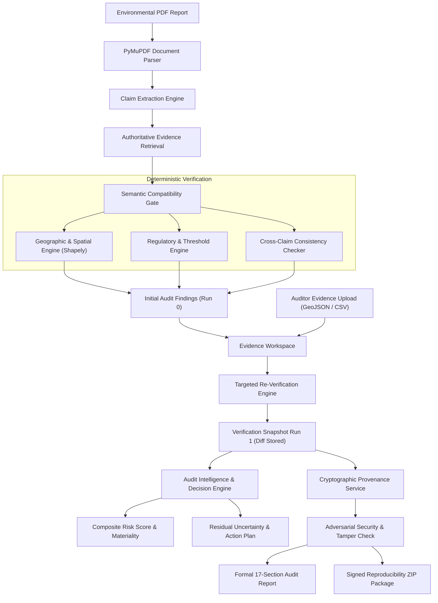

# GroundCheck AI — System Architecture

**Version:** 1.0.0  
**Status:** Release Ready  
**Core Directive:** Deterministic AI Environmental Report Auditor Connecting Claims to Independent Empirical Ground Truth

---

## 1. Executive Architecture Summary

GroundCheck AI is engineered to solve a pervasive problem in environmental impact auditing: **greenwashing and unverified compliance claims in voluminous regulatory filings**. 

Unlike conventional "LLM wrapper" applications that ask generative language models to evaluate truthfulness (introducing hallucinations, sycophancy, and non-deterministic verdicts), GroundCheck AI enforces a strict **Trust Architecture**:

> **Trust Invariant:** Large Language Models are strictly confined to unstructured text extraction and candidate claim formulation. Verification, mathematical calculations, spatial topological analysis, regulatory compliance checks, risk scoring, and audit decisions are executed exclusively by **100% deterministic Python verification engines**.

---

## 2. Trust Architecture & Responsibility Separation

```text
┌─────────────────────────────────────────────────────────────────────────┐
│                      UNSTRUCTURED REGULATORY DOCUMENT                   │
│                     (PDF / Environmental Impact Study)                  │
└────────────────────────────────────┬────────────────────────────────────┘
                                     │
                                     ▼
┌─────────────────────────────────────────────────────────────────────────┐
│                      STAGE 1: DOCUMENT INGESTION                        │
│               PyMuPDF Text & Structural Geometry Parser                 │
└────────────────────────────────────┬────────────────────────────────────┘
                                     │
                                     ▼
┌─────────────────────────────────────────────────────────────────────────┐
│                     STAGE 2: CANDIDATE CLAIM EXTRACTION                 │
│              AI Assistant (Gemini API) OR Deterministic Regex           │
│        (Extracts: Quote, Location, Value, Unit, Claim Category)         │
│               *AI Output Is Strictly Untrusted Candidate Data*          │
└────────────────────────────────────┬────────────────────────────────────┘
                                     │
                                     ▼
┌─────────────────────────────────────────────────────────────────────────┐
│               STAGE 3: INDEPENDENT EVIDENCE RETRIEVAL                   │
│        Authoritative Datasets: OSM GIS, OpenAQ, EPA NAAQS, Regs         │
│          *Acquired bytes hashed via SHA-256 upon reception*             │
└────────────────────────────────────┬────────────────────────────────────┘
                                     │
                                     ▼
┌─────────────────────────────────────────────────────────────────────────┐
│              STAGE 4: SEMANTIC COMPATIBILITY FILTER                     │
│      Checks: Dimension Compatibility, Target Measurement Match,         │
│              Proposition Scope, and Spatial Validity Bounds             │
└────────────────────────────────────┬────────────────────────────────────┘
                                     │
                                     ▼
┌─────────────────────────────────────────────────────────────────────────┐
│            STAGE 5: DETERMINISTIC VERIFICATION ENGINES (SOLE AUTHORITY) │
│                                                                         │
│  ┌──────────────────────┐ ┌──────────────────────┐ ┌─────────────────┐  │
│  │ Geodesic Coordinate  │ │ Geometric Boundary   │ │ Regulatory Limit│  │
│  │ Haversine / WGS84    │ │ Shapely EPSG:4326    │ │ Direct Threshold│  │
│  │ Precision: < 50m     │ │ Polygon Area & Inter.│ │ Value Comparison│  │
│  └──────────────────────┘ └──────────────────────┘ └─────────────────┘  │
│                                                                         │
│  *Returns: VERIFIED, INCONSISTENT, or UNVERIFIABLE (No LLM Decisions)*  │
└────────────────────────────────────┬────────────────────────────────────┘
                                     │
                                     ▼
┌─────────────────────────────────────────────────────────────────────────┐
│              STAGE 6: EVIDENCE WORKSPACE & RE-VERIFICATION              │
│       Auditor Uploads Independent Geometry/Data -> SHA-256 Hashed       │
│    Targeted Re-Verification Runs Executed -> Immutable Run Diff Stored   │
└────────────────────────────────────┬────────────────────────────────────┘
                                     │
                                     ▼
┌─────────────────────────────────────────────────────────────────────────┐
│              STAGE 7: AUDIT INTELLIGENCE & DECISION SUPPORT             │
│      - Deterministic Risk Engine (Composite score clamped [0, 100])    │
│      - Materiality Classification (Statutory, Boundary, Receptor)       │
│      - Weighted Evidence Coverage Metric                                │
│      - Multi-Dimensional Residual Uncertainty Breakdown                 │
│      - "What Would Change This Audit?" Sensitivity Projections         │
└────────────────────────────────────┬────────────────────────────────────┘
                                     │
                                     ▼
┌─────────────────────────────────────────────────────────────────────────┐
│              STAGE 8: CRYPTOGRAPHIC PROVENANCE & LINEAGE                │
│    End-to-end lineage graphs: Source -> Evidence -> Claim -> Finding    │
│    Disk-level SHA-256 tamper verification across all uploaded assets   │
└────────────────────────────────────┬────────────────────────────────────┘
                                     │
                                     ▼
┌─────────────────────────────────────────────────────────────────────────┐
│              STAGE 9: ADVERSARIAL SECURITY & INTEGRITY INVARIANTS       │
│    Rejection of bow-tie self-intersections, coordinate bounds clamping, │
│       unit dimensional mismatch blocks, and path traversal security     │
└────────────────────────────────────┬────────────────────────────────────┘
                                     │
                                     ▼
┌─────────────────────────────────────────────────────────────────────────┐
│              STAGE 10: PRODUCTION EXPORTS & REPRODUCIBILITY             │
│    - Formal 17-Section Markdown Audit Report                            │
│    - Signed Cryptographic Reproducibility Package (.ZIP)               │
└─────────────────────────────────────────────────────────────────────────┘
```

---

## 3. Detailed Subsystem Breakdown

### 3.1 Document Ingestion & Claim Extraction
- **PyMuPDF Parser:** Extracts structured text, page geometries, and font metrics while preserving page boundaries.
- **Candidate Claim Extractor:** Identifies specific factual assertions containing numeric values, units, geospatial coordinates, and environmental parameters.
- **Anti-Hallucination Guard:** If the Gemini API is unconfigured or unreachable, the system automatically falls back to deterministic heuristic extraction without failing or fabricating claims.

### 3.2 Deterministic Verification Engines
1. **Spatial & Geographic Engine (`Shapely` / WGS84):**
   - Coordinates verification calculates Vincenty/Haversine geodesic distances against authoritative spatial ground truth.
   - Boundary verification computes polygon areas using ellipsoidal geodesic projection (WGS84).
   - Distance buffers and corridor non-intersection checks verify residential separation and biodiversity corridor protections.
2. **Regulatory & Threshold Engine:**
   - Evaluates numeric values against statutory standards (e.g., National Ambient Air Quality Standards 8-hour CO limit $\le 9.0\text{ ppm}$).
   - Discrepancy percentages and compliance headroom margins are computed with deterministic floating-point precision.
3. **Cross-Claim Consistency Engine:**
   - Detects internal contradictions within the report (e.g., predicted emissions contradicting baseline ambient air quality measurements).

### 3.3 Evidence Workspace & Targeted Re-Verification
- Auditors upload independent evidence items (GeoJSON boundaries, monitoring logs, satellite alignments).
- Every uploaded item receives an immutable SHA-256 content hash upon ingestion.
- **Targeted Re-Verification:** Only claims impacted by newly uploaded evidence are re-verified. Prior findings are preserved in immutable verification run snapshots (`Run 0` $\to$ `Run 1`), capturing exact status transitions (e.g., `UNVERIFIABLE` $\to$ `VERIFIED`).

### 3.4 Audit Intelligence & Decision Support
- **Risk Score Algorithm:** Calculates a deterministic composite risk score ($0$ to $100$) driven by:
  - Base document uncertainty ($40.0\text{ pts}$)
  - Unverifiable material claims ($+5.0\text{ pts}$ each)
  - Severe physical inconsistencies ($+25.0\text{ pts}$ each)
  - Verified mitigations ($-5.0\text{ pts}$ each)
  - Monotonically clamped within $[0, 100]$.
- **Sensitivity Analysis ("What Would Change This Audit?"):** Deterministically computes what specific evidence (e.g., haul road alignment GeoJSON) would downgrade audit risk from MODERATE to LOW.

### 3.5 Provenance, Security & Signed Reproducibility
- **Cryptographic Manifest:** Every audit generates an `audit_manifest.json` signing the report hash, evidence hashes, and verification run identifiers.
- **Reproducibility Package:** Downloads a self-contained ZIP archive containing all raw data, schemas, scripts, and calculated outputs enabling third-party auditors to verify 100% bit-for-bit equivalence.

---

## 4. Pipeline Flow Diagram (Mermaid)



---

## 5. Technology Stack

- **Backend:** FastAPI (Python 3.11), Pydantic v2, Shapely 2.0, PyMuPDF, Requests, Uvicorn
- **Frontend:** Next.js 16 (App Router), React 19, Tailwind CSS v4, Lucide React
- **Cryptography:** Python `hashlib` (SHA-256), HMAC-SHA256
- **Geospatial Processing:** WGS84 Geodesic, GeoJSON RFC 7946, Shapely planar geometry
- **Deployment:** Docker Multi-stage containers, Docker Compose, non-root system users

